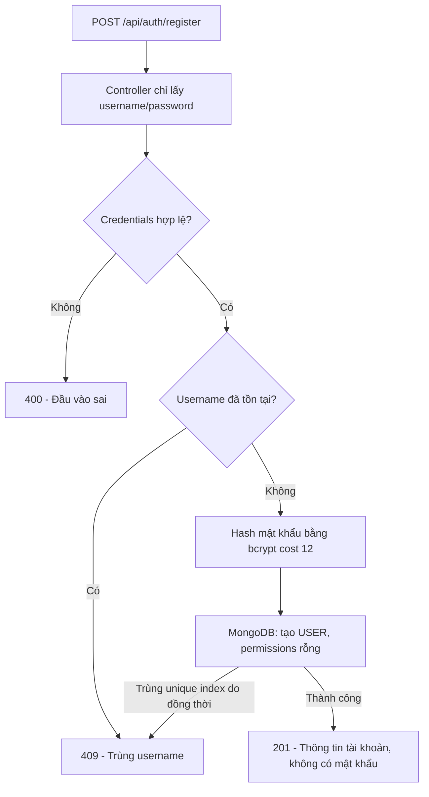
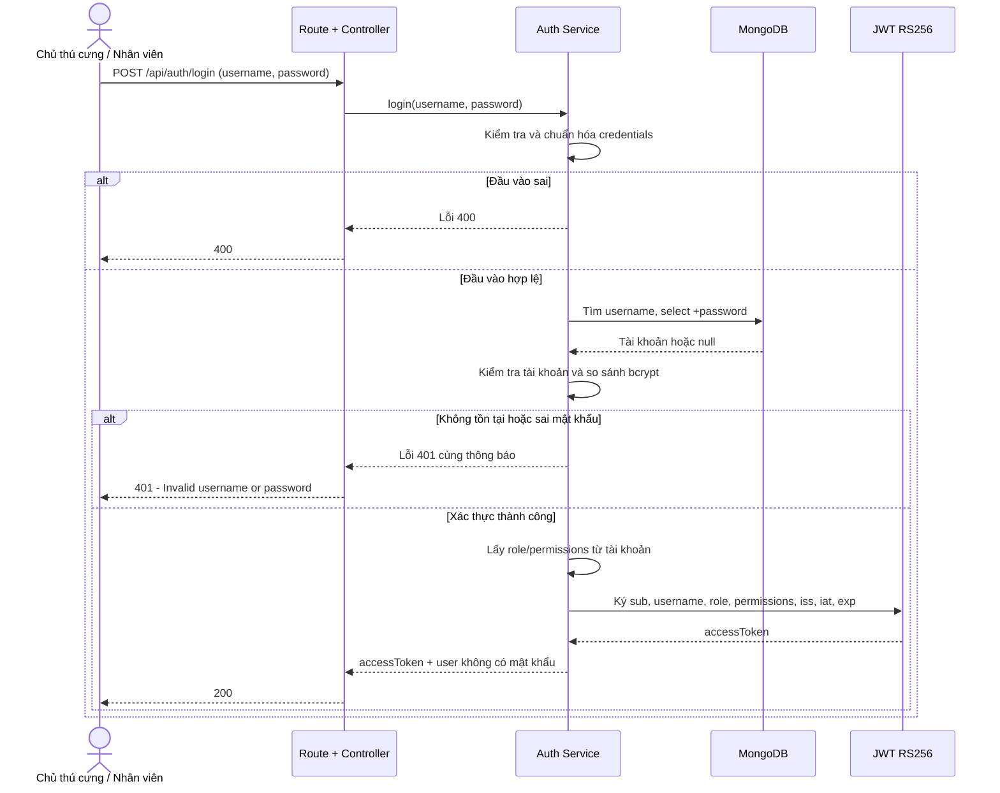
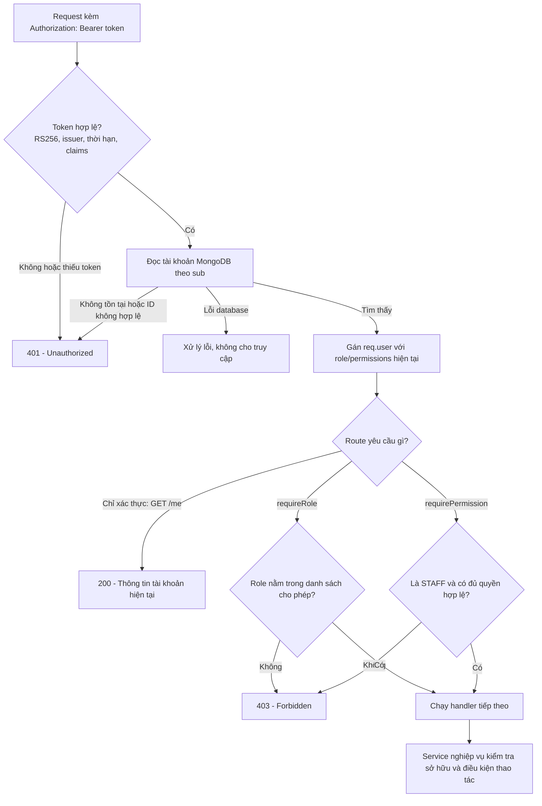
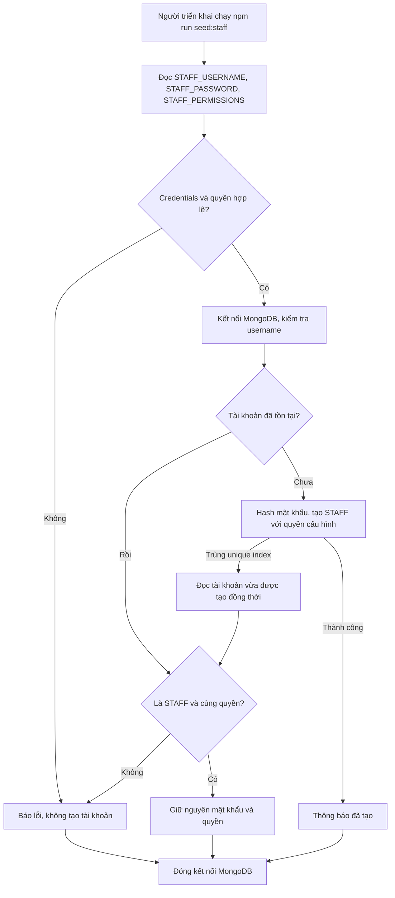

# PawStay Auth Service

Auth service dùng Node.js, Express, MongoDB/Mongoose, bcryptjs và JWT RS256. Triển khai theo `docs/idea.md`, mục 3–4 và 6: chỉ có Chủ thú cưng và Nhân viên; không có Admin. Giữ nguyên công nghệ hiện tại dù tài liệu ý tưởng đề xuất FastAPI/MySQL.

## Cây thư mục

```text
Backend/auth-service/
├── server.js                    # Nạp .env, kiểm tra JWT, kết nối DB, mở server
├── script.js                    # Sinh cặp khóa RSA theo đường dẫn trong .env
├── package.json                 # Dependencies và lệnh start/test/seed
├── package-lock.json            # Khóa phiên bản dependencies
├── .env.example                 # Cấu hình mẫu, gồm STAFF_PERMISSIONS
├── .gitignore                   # Bỏ qua .env, keys, node_modules
├── README.md
├── scripts/
│   └── seed-staff.js             # Tạo STAFF thường hoặc STAFF có quyền đổi giá
├── src/
│   ├── app.js                    # Express, JSON parser, routes và xử lý lỗi
│   ├── config/
│   │   ├── authorization.js      # Hai vai trò và danh sách quyền hợp lệ
│   │   ├── database.js           # Kết nối MongoDB, khởi tạo index
│   │   └── jwt.js                # Ký/xác minh JWT RS256 và kiểm tra cấu hình
│   ├── controllers/
│   │   └── auth.controller.js    # Nhận request, gọi service, trả response
│   ├── middleware/
│   │   └── auth.middleware.js    # authenticate, requireRole, requirePermission
│   ├── models/
│   │   └── auth.model.js         # Schema tài khoản, role, permissions
│   ├── routes/
│   │   └── auth.routes.js        # /register, /login, /me
│   ├── services/
│   │   └── auth.service.js       # Đăng ký, đăng nhập, lọc thông tin công khai
│   └── utils/
│       └── validation.js         # Kiểm tra credentials và tạo lỗi HTTP
└── test/
    ├── auth.test.js              # Luồng HTTP, JWT, seed và phân quyền
    └── model.test.js             # Kiểm tra schema Mongoose
```

Khi thiết lập môi trường, người triển khai tạo thêm `.env` và thư mục `keys/` chứa `private.pem`, `public.pem`; các file này không đưa vào Git. `node_modules/` được tạo khi cài dependencies và được lược bỏ khỏi cây.

## Sơ đồ luồng

Các sơ đồ dùng Mermaid; mở README bằng trình xem hỗ trợ Mermaid để hiển thị hình.

### Đăng ký chủ thú cưng



### Đăng nhập và cấp JWT



### Xác thực và kiểm tra quyền trên từng yêu cầu



`requireRole` và `requirePermission` có thể được xếp nối tiếp nếu route cần cả hai; sơ đồ thể hiện riêng từng bước kiểm tra. Trong Auth hiện tại, chỉ `/me` cần `authenticate`; các route nghiệp vụ trong tài liệu là ví dụ tích hợp. Quyền lấy từ MongoDB giúp việc thu hồi quyền có hiệu lực ngay tại các route sử dụng middleware này.

### Khởi tạo nhân viên qua script



Quyền cấu hình rỗng tạo nhân viên thường; `UPDATE_SERVICE_PRICE` tạo nhân viên được ủy quyền. Script không tự sửa quyền của tài khoản có sẵn.

Các sơ đồ tập trung vào luồng chính; lỗi hệ thống khác được chuyển tới bộ xử lý lỗi chung, trả 500 khi không thuộc nhóm lỗi đầu vào 4xx.

## Báo cáo thay đổi

- Giữ `USER` cho Chủ thú cưng và `STAFF` cho Nhân viên để tương thích API hiện tại.
- Bổ sung `permissions` vào tài khoản, phản hồi đăng nhập và JWT; chỉ chấp nhận `UPDATE_SERVICE_PRICE` trên tài khoản STAFF.
- Đăng ký công khai luôn tạo USER với `permissions: []`. Controller chỉ lấy username/password; role, permissions và các trường khác từ client bị bỏ qua.
- Thêm middleware `requirePermission` bên cạnh `requireRole`; thêm `GET /api/auth/me` trả danh tính và quyền hiện tại.
- `authenticate` kiểm tra chữ ký RS256, issuer, thời hạn và cấu trúc claims, sau đó đọc tài khoản từ MongoDB. Quyền hiện tại trong database được dùng để quyết định truy cập, không dùng quyền cũ trong JWT. Tài khoản không còn tồn tại trả 401; lỗi database chuyển tới bộ xử lý lỗi, không cho qua.
- Seed hỗ trợ cấp quyền khi tạo nhân viên. Chạy lại không đổi mật khẩu/quyền; nếu quyền cấu hình khác tài khoản hiện tại, script báo lỗi để tránh hiểu nhầm đã cấp quyền.
- Không thêm dependency, không thay collection `auths`, không có API cấp quyền hoặc tạo nhân viên trên web.

## Ma trận phân quyền

| Hoạt động | USER (Chủ thú cưng) | STAFF thường | STAFF có UPDATE_SERVICE_PRICE |
|---|---|---|---|
| Đăng ký công khai | Có | Tạo qua script | Tạo qua script |
| Đăng nhập, xem /me | Có | Có | Có |
| Hồ sơ, booking, thanh toán, lịch sử | Chỉ dữ liệu của mình | Thông tin cần thiết cho vận hành | Như STAFF thường |
| Check-in/out, ghi nhật ký, tình trạng tài nguyên | Không | Có, theo điều kiện nghiệp vụ | Có, theo điều kiện nghiệp vụ |
| Cập nhật bảng giá Catalog | Không | Không | Có |
| Sửa giá booking đã chốt/kết quả thanh toán | Không | Không | Không |
| Tự cấp quyền/tạo nhân viên qua web | Không | Không | Không |

Auth cung cấp danh tính và cơ chế kiểm tra role/permission. Pet, Booking, Payment, Care và Catalog phải thực thi quy tắc tại endpoint của mình. Các API nghiệp vụ trên chưa được triển khai trong auth service.

Đối với dữ liệu của khách, service sở hữu tài nguyên phải lấy `owner_id` từ dữ liệu đã lưu và so sánh với `req.user.sub`; không tin `owner_id` hoặc role frontend gửi lên. Quyền STAFF không tự động cho phép mọi hành động. Check-in/out, hủy booking và thanh toán còn phải kiểm tra trạng thái nghiệp vụ.

## Chạy dịch vụ

Chạy từ thư mục `Backend/auth-service`, Node.js 24 trở lên:

```powershell
npm ci
Copy-Item .env.example .env
npm run generate:keys
npm start
```

Cấu hình `MONGODB_URI`, `JWT_PRIVATE_KEY_PATH`, `JWT_PUBLIC_KEY_PATH`, `JWT_ISSUER`, `JWT_EXPIRES_IN` (mặc định 1h) và `PORT` (mặc định 3001) trong `.env`. Đường dẫn key tương đối tính từ thư mục chạy lệnh. Private key chỉ đặt trong Auth; không commit `.env`/keys.

Chạy `node script.js` hoặc `npm run generate:keys` để sinh RSA 2048-bit, private key PKCS#8 và public key SPKI dạng PEM, tương thích JWT RS256. Script đọc hai đường dẫn JWT trong `.env`, tự tạo thư mục cha và từ chối ghi đè nếu một trong hai khóa đã tồn tại. Đường dẫn tương đối của script được tính từ thư mục auth-service.

Startup kiểm tra cặp key và cấu hình JWT, kết nối MongoDB, tạo unique index username trước khi lắng nghe. Nếu dữ liệu cũ có username trùng, cần xử lý trước; không tự xóa dữ liệu hoặc seed khi khởi động.

## API

### POST /api/auth/register

```json
{ "username": "owner01", "password": "password123" }
```

Trả 201: `{ "success": true, "message": "Registration successful", "data": { "user": { "id": "...", "username": "owner01", "role": "USER", "permissions": [] } } }`.

Username trim, phân biệt hoa thường, 1–100 ký tự. Mật khẩu đăng ký tối thiểu 8 ký tự, tối đa 72 byte UTF-8, không trim. Hash bcrypt cost 12, không trả hash qua API. Đầu vào sai trả 400; username trùng (kể cả tranh chấp unique index) trả 409.

### POST /api/auth/login

Cùng body username/password cho cả hai vai trò. Trả 200 với `data.accessToken` và `data.user` gồm id, username, role, permissions. JWT gồm sub, username, role, permissions, iat, exp, iss. Sai username/mật khẩu đều trả 401 với cùng thông báo. Đăng nhập vẫn nhận mật khẩu cũ ngắn hơn 8 ký tự, tối đa 72 byte.

### GET /api/auth/me

Gửi `Authorization: Bearer <accessToken>`. Trả 200 với `data.user` lấy từ MongoDB (không gồm mật khẩu). Thiếu/sai/hết hạn token hoặc tài khoản bị xóa trả 401. Đã xác thực nhưng thiếu role/permission tại route được bảo vệ trả 403.

## Tích hợp phân quyền

```javascript
const { authenticate, requireRole, requirePermission } = require('./middleware/auth.middleware');
router.get('/owner-route', authenticate, requireRole('USER'), handler);
router.get('/staff-route', authenticate, requireRole('STAFF'), handler);
router.patch('/price', authenticate, requireRole('STAFF'),
  requirePermission('UPDATE_SERVICE_PRICE'), handler);
```

Đây là ví dụ gắn middleware, không phải endpoint Catalog đã triển khai. `req.user.sub`/`req.user.id` là ID tài khoản MongoDB; `req.user.role` và `req.user.permissions` là giá trị hiện tại từ database. Quyền không nhận diện bị từ chối.

Service khác không được đọc trực tiếp database Auth. Có thể xác minh JWT bằng public key, RS256, issuer và hạn dùng; muốn quyền được thu hồi có hiệu lực ngay, gọi `/api/auth/me` với token người dùng và kiểm tra role/permissions trả về ở mỗi yêu cầu nhạy cảm. Nếu chỉ xác minh JWT offline, quyền là snapshot và có thể cũ đến khi token hết hạn. Khi Auth không khả dụng, không cho phép thao tác cần kiểm tra quyền mới nhất. API nội bộ giữa các service cần cơ chế xác thực service riêng; JWT người dùng không thay thế danh tính service. Cơ chế này chưa được triển khai ở đây.

## Khởi tạo nhân viên

Trong `.env`:

```dotenv
STAFF_USERNAME=staff01
STAFF_PASSWORD=replace-with-a-strong-password
STAFF_PERMISSIONS=
```

Chạy `npm run seed:staff` để tạo nhân viên thường. Để tạo nhân viên được ủy quyền, dùng username khác và `STAFF_PERMISSIONS=UPDATE_SERVICE_PRICE`, rồi chạy lại lệnh. Không có mật khẩu mẫu được tự tạo trong database.

Script chỉ tạo tài khoản nếu username chưa tồn tại; USER trùng tên hoặc STAFF có quyền khác cấu hình gây lỗi, không sửa tài khoản. STAFF cùng quyền được giữ nguyên cả hash. Muốn thay đổi quyền tài khoản có sẵn, người triển khai phải cập nhật có kiểm soát trong MongoDB sau khi kiểm tra đúng tài khoản STAFF; không có API/web tự cấp quyền. Script chỉ quản lý tài khoản Auth, không tác động dữ liệu giá Catalog.

## Tương thích dữ liệu cũ

Tài khoản chưa có permissions được hiểu là `[]`; role user/staff chữ thường được chuẩn hóa khi đăng nhập/đọc danh tính. Schema mới chỉ chấp nhận USER/STAFF, nên cần chuẩn hóa role trước khi lưu lại tài khoản cũ. Không có migration tự động. Các role/quyền ngoài danh sách không được dùng để cấp quyền. JWT cũ thiếu permissions vẫn được nhận nếu hợp lệ; middleware lấy quyền hiện tại từ MongoDB.

## Kiểm thử và giới hạn

Chạy `npm test`. Đã chạy thành công 2 bài kiểm thử: luồng HTTP dùng bcrypt/RSA thật và model MongoDB được mock; kiểm thử schema dùng Mongoose thật, không cần kết nối database. Kiểm tra đăng ký/đăng nhập, chống chèn role/permissions, dữ liệu sai, trùng username và race, hash mật khẩu, seed chạy lại/xung đột, JWT sai chữ ký/issuer/hết hạn, 401/403, USER/STAFF, nhân viên thường/được ủy quyền, /me, thu hồi quyền khi token còn hạn và xóa tài khoản. Kiểm thử schema xác nhận trường permissions được giữ lại, chỉ STAFF nhận quyền bổ sung, từ chối role/quyền lạ và không lộ hash qua JSON.

Rà soát và khôi phục ngày 17/11/2026: viết lại auth.service.js theo CommonJS, sửa đường dẫn model, khôi phục export đăng ký và publicUser, lấy password bằng select('+password') khi đăng nhập; khôi phục permissions và kiểm tra role bắt buộc trong model; xóa ký tự thừa gây lỗi nạp middleware. Bổ sung từ chối role tài khoản không hợp lệ, kiểm tra sub JWT là chuỗi không rỗng và trả 401 khi sub không thể chuyển thành ID MongoDB. Đã kiểm tra cú pháp toàn bộ file JavaScript trong src, scripts, test và server.js.

Chưa kiểm thử với MongoDB đang chạy, unique index thực tế hoặc toàn bộ các service nghiệp vụ; không tạo tài khoản thực. Không có refresh token, logout thu hồi token riêng lẻ hay giới hạn số lần đăng nhập. Workspace không có Git repository nên không thể xác minh bằng git diff/status.
